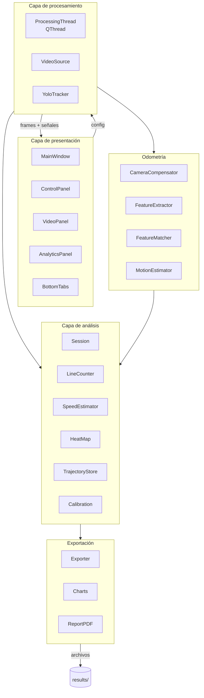

<h1 align="center">Vision Tracker</h1>

<p align="center">
  <b>Sistema de visión artificial para tracking multiobjeto, radar de velocidad, analítica de tránsito y compensación de cámara mediante odometría visual.</b>
</p>

<p align="center">
  
  
  
  
  
</p>

---

## Descripción

Vision Tracker es una aplicación de escritorio que integra detección y seguimiento de objetos con YOLO y trackers multiobjeto, análisis de movimiento, calibración espacial por homografía, mapas de calor, analítica de tránsito y compensación de movimiento de cámara mediante odometría visual 2D con ORB.

El sistema está diseñado para escenarios de videovigilancia y análisis de tráfico, y demuestra la complementariedad entre el tracking de objetos y la odometría visual: el tracker responde qué objeto es y dónde está; la odometría responde cómo se movió la cámara. Restando ambos se recupera el movimiento real del objeto cuando la cámara se desplaza.

---

## Tabla de contenidos

- [Características](#características)
- [Arquitectura](#arquitectura)
- [Estructura del proyecto](#estructura-del-proyecto)
- [Instalación](#instalación)
- [Uso](#uso)
- [Perfiles de análisis](#perfiles-de-análisis)
- [Resultados exportados](#resultados-exportados)
- [Pruebas](#pruebas)
- [Licencia](#licencia)

---

## Características

<table>
<tr>
<td width="50%">

**Detección y tracking**
- YOLO11 / YOLOv8 con Ultralytics
- ByteTrack y BoT-SORT
- IDs persistentes entre fotogramas
- Filtro por clases COCO con presets

**Análisis de movimiento**
- Línea virtual con conteo bidireccional
- Velocidad instantánea con timestamps reales
- Dirección y sentido por objeto
- Calibración espacial por homografía (px/s → km/h)

</td>
<td width="50%">

**Analítica**
- Mapas de calor: densidad y movimiento
- Trayectorias por objeto
- Detecciones por intervalo de tiempo
- Cruces por hora con hora pico resaltada

**Odometría visual**
- ORB (FAST + BRIEF) sobre fondo estático
- BFMatcher + ratio de Lowe
- Estimación robusta con RANSAC
- Cinco criterios de validación
- Compensación de coordenadas por objeto

</td>
</tr>
</table>

---

## Arquitectura

El sistema sigue una arquitectura por capas con separación estricta entre configuración, procesamiento, análisis y presentación.



El hilo de procesamiento nunca bloquea la interfaz: recibe los ajustes en vivo por un mutex, procesa captura, detección, análisis y dibujo, y emite señales con fotogramas ya anotados y métricas.

---

## Estructura del proyecto

```
VISION_TRACKER/
├── main.py                     # Punto de entrada
├── README.md
├── requirements.txt
│
├── config/
│   ├── settings.py             # Constantes, perfiles, parámetros por defecto
│   └── classes.py              # Clases COCO y presets de selección
│
├── core/
│   ├── pipeline.py             # QThread de procesamiento
│   ├── detector.py             # Envoltura de Ultralytics YOLO
│   ├── session.py              # Estado de una ejecución
│   ├── tracker.py              # Dataclass Track
│   ├── trajectory.py           # Almacén de trayectorias
│   ├── line_counter.py         # Cruces por línea virtual
│   ├── speed_estimator.py      # Velocidad con timestamps reales
│   ├── heatmap.py              # Mapas de densidad y movimiento
│   ├── calibration.py          # Homografía del plano del suelo
│   ├── renderer.py             # Anotaciones sobre el fotograma
│   └── video_capture.py        # Fuente unificada archivo/webcam
│
├── odometry/
│   ├── feature_extractor.py    # ORB con máscara de objetos
│   ├── feature_matcher.py      # BFMatcher + ratio de Lowe
│   ├── motion_estimator.py     # RANSAC + similitud 2D
│   └── camera_compensation.py  # Acumulación y compensación
│
├── analytics/
│   ├── statistics.py           # Resumen de sesión
│   ├── exporter.py             # Exportación CSV/JSON/PNG
│   ├── charts.py               # Gráficas con matplotlib
│   └── report_pdf.py           # Reporte PDF opcional
│
├── interface/
│   ├── main_window.py          # Ventana principal
│   ├── control_panel.py        # Panel de configuración
│   ├── video_panel.py          # Visor con zoom y captura de puntos
│   ├── analytics_panel.py      # Tarjetas y pestañas inferiores
│   ├── session_history.py      # Historial de sesiones
│   ├── calibration_dialog.py   # Diálogo de medidas reales
│   └── styles.qss              # Tema oscuro
│
├── tests/
│   ├── test_logic.py           # Pruebas de lógica pura
│   ├── test_pipeline.py        # Flujo completo con videos sintéticos
│   ├── test_gui.py             # Pruebas de interfaz offscreen
│   └── fake_detector.py        # Detector simulado por color
│
├── models/                     # Pesos YOLO (.pt)
├── results/                    # Sesiones exportadas
└── data/
    └── exports/                # Exportaciones auxiliares
```

---

## Instalación

### Requisitos

- Python 3.10 o superior
- Sistema operativo: Windows, Linux o macOS
- GPU opcional (CPU suficiente para los modelos `n`)

### Pasos

```bash
# 1. Clonar el repositorio
git clone https://github.com/<usuario>/vision-tracker.git
cd vision-tracker

# 2. Crear entorno virtual
python -m venv .venv
source .venv/bin/activate        # Linux / macOS
.venv\Scripts\activate           # Windows

# 3. Instalar dependencias
pip install -r requirements.txt

# 4. (Opcional) Descargar pesos YOLO
# Ultralytics los descarga automáticamente en el primer uso,
# o colócalos manualmente en models/
```

### Dependencias principales

| Paquete | Uso |
|---|---|
| `ultralytics` | YOLO y trackers |
| `opencv-python` | Captura, ORB, homografía |
| `PySide6` | Interfaz gráfica |
| `pyqtgraph` | Gráficas en vivo |
| `matplotlib` | Gráficas de exportación |
| `pandas` | Exportación CSV |
| `numpy` | Álgebra numérica |

---

## Uso

```bash
python main.py
```

### Flujo típico

1. **Fuente**: abrir un archivo de video o seleccionar una webcam.
2. **Modo y perfil**: elegir cámara fija o móvil, y el perfil de análisis.
3. **Configuración opcional**:
   - Definir línea virtual (2 clics sobre el video).
   - Calibrar escena (4 clics sobre el suelo + medidas reales).
   - Ajustar límite de velocidad (perfil radar).
4. **Iniciar**: procesar el video con detección, tracking y análisis.
5. **Exportar**: al finalizar se genera la carpeta de sesión con todos los resultados.

### Atajos de teclado

| Tecla | Acción |
|---|---|
| `F11` | Pantalla completa |
| `Esc` | Salir de pantalla completa |
| Rueda del ratón | Zoom sobre el video |
| Clic derecho / medio | Desplazar el video ampliado |

---

## Perfiles de análisis

<table>
<tr>
<th>Perfil</th>
<th>Modos</th>
<th>Características activas</th>
<th>Caso de uso</th>
</tr>
<tr>
<td><b>General</b></td>
<td>Fija, móvil</td>
<td>Tracking, trayectorias</td>
<td>Tracking básico (ítem 2B)</td>
</tr>
<tr>
<td><b>Análisis de movimiento</b></td>
<td>Fija</td>
<td>+ Línea, velocidad, heatmap, calibración</td>
<td>Velocidad y zonas (ítem 2C)</td>
</tr>
<tr>
<td><b>Compensación de cámara</b></td>
<td>Móvil</td>
<td>+ Odometría visual, velocidad</td>
<td>Cámara en movimiento (ítem 2D)</td>
</tr>
<tr>
<td><b>Radar de velocidad</b></td>
<td>Fija</td>
<td>+ Alertas por exceso de velocidad</td>
<td>Radar con límite (Nivel 1)</td>
</tr>
<tr>
<td><b>Analítica de tránsito</b></td>
<td>Fija</td>
<td>+ Flujo por sentido, cruces por hora</td>
<td>Analítica de tráfico (Nivel 2)</td>
</tr>
</table>

---

## Resultados exportados

Cada sesión genera una carpeta en `results/` con el siguiente contenido:

<table>
<tr>
<td width="33%">

**Configuración**
- `configuration.json`
- `summary.json`

**Datos CSV**
- `trajectories.csv`
- `detections.csv`
- `objects.csv`
- `crossings.csv` (si aplica)
- `camera_motion.csv` (si aplica)

</td>
<td width="33%">

**Gráficas PNG**
- `heatmap_density.png`
- `heatmap_motion.png`
- `trajectories.png`
- `objects_by_class.png`
- `speed_distribution.png`
- `detections_over_time.png`
- `crossings_by_hour.png` (si aplica)
- `traffic_flow.png` (si aplica)

</td>
<td width="34%">

**Otros**
- `processed.mp4` (si se solicita)
- `report.pdf` (si se solicita)

</td>
</tr>
</table>

### Ejemplo de `summary.json`

```json
{
  "session": "20261123_222519_7-Calle-20s",
  "status": "completada",
  "camera_mode": "fixed",
  "analysis_profile": "radar",
  "total_unique_objects": 96,
  "speed": {
    "avg_kmh": 8.80,
    "max_kmh": 67.71,
    "calibrated": true
  },
  "crossings": { "total": 3, "A->B": 3, "B->A": 0 },
  "not_available": { ... },
  "notes": [ ... ]
}
```

El campo `not_available` registra explícitamente los datos que no pudieron calcularse, y el campo `notes` documenta las limitaciones metodológicas del análisis.

---

## Pruebas

El proyecto incluye tres niveles de pruebas que no requieren GPU ni videos externos.

```bash
# Pruebas de lógica pura
python -m tests.test_logic

# Flujo completo con videos sintéticos
python -m tests.test_pipeline

# Interfaz en modo offscreen
QT_QPA_PLATFORM=offscreen python -m tests.test_gui
```

<table>
<tr>
<th>Archivo</th>
<th>Cobertura</th>
</tr>
<tr>
<td><code>test_logic.py</code></td>
<td>LineCounter, SpeedEstimator, Calibration, CameraCompensator</td>
</tr>
<tr>
<td><code>test_pipeline.py</code></td>
<td>Flujo completo fijo, móvil y sin calibración</td>
</tr>
<tr>
<td><code>test_gui.py</code></td>
<td>Mapeo de coordenadas, línea por clics, calibración, fluidez de la UI</td>
</tr>
</table>

Las pruebas utilizan un detector simulado por color (`fake_detector.py`) que evita depender de YOLO y hace los tests deterministas y rápidos.

---

## Limitaciones

- La compensación de cámara es una similitud 2D, no odometría visual 3D. No estima profundidad ni corrige paralaje fuerte.
- En cámara móvil no se calcula velocidad en km/h porque la homografía asume un plano fijo.
- Los mapas de calor solo se generan en cámara fija, donde las posiciones son comparables entre fotogramas.
- Si el tracker cambia el ID de un objeto, el conteo de objetos únicos puede sobrestimar el total real.
- El detector YOLO puede fallar con objetos muy pequeños, muy ocluidos o en condiciones de baja iluminación.

---
## Licencia

Distribuido bajo la licencia MIT. Consulta el archivo `LICENSE` para más información.

---

<p align="center">
  <sub>Desarrollado como proyecto integrador del curso de Visión Artificial.</sub>
</p>
```
